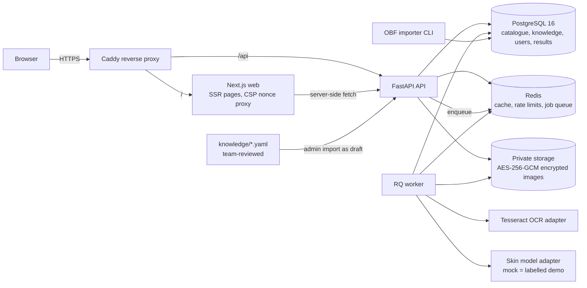

# Architecture

SkinSync is a **modular monolith**: one FastAPI application with separate domain packages, one
RQ worker process for slow jobs, and a Next.js frontend. All three pipelines (skin, compatibility,
alternatives) share one product and ingredient knowledge base.

## Components

## Code layout

| Path | Responsibility |
|---|---|
| `apps/api/skinsync/domain/` | Pure, framework-free logic: `ingredients` (parse + normalise), `knowledge` (rules, evidence, loader), `compatibility` (deterministic engine), `alternatives` (ranking), `images` (validation), `skin` (adapter contract, concern mapping), `ocr` |
| `apps/api/skinsync/services/` | Database-backed services: `catalog`, `knowledge`, `comparisons`, `recommend` |
| `apps/api/skinsync/api/` | HTTP routers (thin): validation, auth, ownership, response shaping |
| `apps/api/skinsync/jobs.py`, `worker.py` | Background jobs: skin analysis, OCR, retention cleanup |
| `apps/api/skinsync/ingest/` | Open Beauty Facts importer + category map |
| `apps/api/migrations/`, `alembic/` | Reviewed SQL migrations run through Alembic |
| `apps/web/src/` | Next.js App Router pages, shared components, generated API types |
| `knowledge/` | Reviewed rules, evidence, ingredient master, concern map (ship empty); `knowledge/demo/` fictional |

## Key design decisions

* **Deterministic core.** `domain.compatibility.evaluate(a, b, kv)` has no I/O, clock or randomness.
  Results are byte-identical for the same inputs (tested) and stamped with formulation, knowledge and
  engine versions.
* **AI only for perception.** OCR and the skin model sit behind adapters whose outputs are validated by
  Pydantic before domain code sees them. A model never chooses a product or decides compatibility.
* **Shared contracts.** Domain result models are published into the OpenAPI document; the frontend's
  TypeScript types are generated from it (`npm run gen:api`). CI fails if the committed schema is stale.
* **Correct caching by construction.** The comparison cache key contains every input that can change a
  result (both formulation version ids, knowledge version, engine version), so changes produce new keys.
* **Database-enforced integrity.** Triggers block publishing rules without evidence, publishing fixture
  evidence as real, editing published knowledge, sharing skin analyses, and updating the audit log.
* **Graceful degradation.** Redis outages make the limiter and cache fail open; queue outages only
  disable OCR and skin analysis (tested). Readiness reports `degraded`, not `down`.

See `architecture-decisions/` for the recorded trade-offs, `uml/` for diagrams, `er.md` for the schema.
