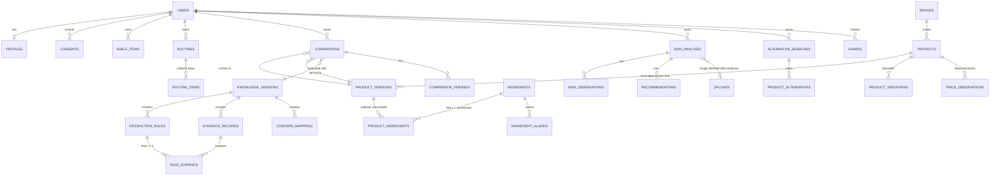

# Entity-relationship model

Source of truth: `apps/api/migrations/*.sql` (37 tables). This diagram shows the core entities; audit,
analytics, auth-token and job tables are listed in `data-dictionary.md`.

## Rules the schema enforces

| Rule | Mechanism |
|---|---|
| An unresolved ingredient has no canonical id and confidence 0 | CHECK on `product_ingredients` |
| One current formulation per product | partial unique index `product_versions_one_current` |
| A rule cannot be published without evidence | trigger `knowledge_publish_guard` |
| Fixture evidence cannot be published as real knowledge | same trigger |
| Published or retired knowledge cannot change | trigger `knowledge_immutable_guard` on rules, evidence, links, mappings |
| Only one published real knowledge version | partial unique index |
| Skin analyses cannot be shared | trigger `shares_no_skin` |
| Skin images must be encrypted | CHECK on `uploads` |
| Guest results cannot be marked saved | CHECK on `comparisons`, `alternative_searches` |
| Deleting a user deletes all personal rows | `ON DELETE CASCADE` on every user FK |
| Audit log is append-only | trigger `audit_append_only` |
| Accounts require 18+ confirmation; emails unique case-insensitively | CHECK + unique index on `lower(email)` |
